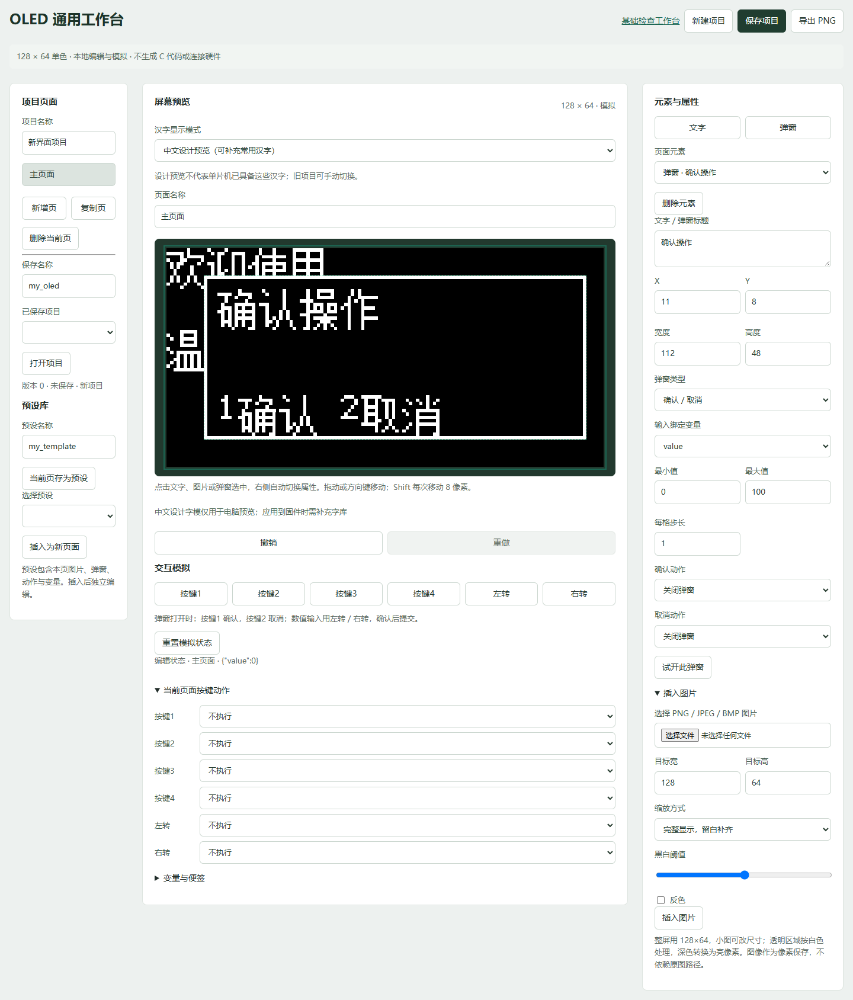

> **桌面套装与联动入口：** 主体维护在 [wiring-workbench](https://github.com/9595846/wiring-workbench)，支持独立运行、设计预览联动与统一启动器。详见 [套装说明](docs/WORKBENCH_SUITE.md)。本仓库原有独立使用说明与代码继续保留。

# OLED UI Workbench · OLED 界面设计与 STM32 接入

为 128×64 单色 OLED 制作的本地中文界面编辑器：编辑文字、图片和弹窗，模拟按键与旋钮，保存项目与预设，通过网页或 MCP 导出待审阅的 C 文件，再接入 STM32 Keil 工程。



## 能做什么

- 点击元素显示选框和属性，调整文字、坐标，支持拖动、撤销和重做。
- 中文设计预览与严格字库模式；提示缺字、越界，避免将电脑效果误认为硬件支持。
- 导入图片并转换为单色，支持提示、确认及数值输入弹窗。
- 多页面、变量、按键与旋钮模拟；保存项目和独立页面预设。
- 网页与 MCP 共用已保存草稿，使用修订号检查并发冲突。
- 导出 `ui_assets`、`ui_pages`、`ui_actions` C/H 文件、设计 JSON 和接入说明。
- 网页仅监听本机，不直接连接串口、驱动舵机或烧录。

## 快速启动（Windows）

需要 Python 3.10+，中文补充预览需要 Windows 宋体。先进入克隆后的仓库根目录：

```powershell
python -m venv oled_preview/.venv
./oled_preview/.venv/Scripts/python.exe -m pip install -r oled_preview/requirements.txt
./oled_preview/.venv/Scripts/python.exe -X utf8 oled_preview/server.py
```

打开终端显示的本地地址，然后进入“通用编辑器”；或在地址后加 `/studio`。以后可以双击 `oled_preview/start_editor.cmd` 启动。端口动态分配，不应收藏某个旧端口。

Python 依赖：Pillow 12.3.0、官方 Python MCP SDK 1.30.0。当前版本以 Windows 为验证环境，不承诺 Linux/macOS 中文预览或文件锁兼容。

## 从设计到开发板

1. 在 `/studio` 编辑，保存项目后点击“导出 C 文件”。
2. 生成文件位于 `oled_preview/exports/project_保存名称/`，不会自动覆盖固件。
3. 阅读导出接入说明，核对按键和硬件业务后，只更新当前工程必要文件。
4. 用 Keil 编译、下载，再在实际 OLED 上验收。

随仓库附带的 `defuse_box/firmware` 已接入 `examples/my_oled.json` 对应的简单设计：第 5 页仅在 (38,4) 显示“主页面”。原有按键旋钮、光敏、IMU、舵机四个检查页保留，KEY4 (PB9) 循环五页，串口 `PAGE 5` 可直接进入。

此示例没有游戏流程、弹窗或硬件动作绑定。编辑器支持这些设计能力，不代表示例固件已经全部接入。当前第五页保留 KEY4 作为全局翻页，未将其它按键和旋钮映射到导出交互；添加交互需要单独核对。

## 固件环境与接线

- STM32F103C8，64KB Flash / 20KB RAM。
- Keil μVision5，用户环境 MDK 5.34；实际编译器 ARMCC 5.06 update 7 build 960。
- STM32F10x 标准外设库，ST-Link / SWD 下载。
- OLED PB10/PB11；IMU PB6/PB7；光敏 AO 接 PA1；舵机信号 PA8。
- KEY1 PB12、KEY2 PB15、KEY3 PB8、KEY4 PB9。
- 舵机使用独立合适电源并与主控共地。

完整说明：[接线与检查](defuse_box/firmware/README_烧录与检查.md)、[第五页接入验收](defuse_box/firmware/UI_INTEGRATION.md)。

用 Keil 打开 `defuse_box/firmware/Project.uvprojx`，目标 `Defuse_Base`，Rebuild 后通过 ST-Link 下载。仓库不提交本机 `.uvoptx`，首次下载请自行选择 ST-Link Debugger / SW。本仓库不附预编译 HEX，编译脚本会在本机生成。

## MCP

MCP 是可选的本地 stdio 接口。无需 MCP 也能使用网页。客户端配置的进程参数示例（将路径改为你的实际位置）：

```json
{
  "command": "C:/work/oled-ui-workbench/oled_preview/.venv/Scripts/python.exe",
  "args": ["-X", "utf8", "C:/work/oled-ui-workbench/oled_preview/mcp_server.py"]
}
```

可用工具：`read_pages`、`read_draft`、`update_draft`、`inspect_preview`、`export_ui`。MCP 读取已保存草稿；网页尚未保存的修改不会自动同步。导出需要最新 revision，不修改工程、不编译、不烧录。

## 验证记录

- 导出模块已通过 GCC 与 ARMCC 编译，含图片、弹窗确认/取消等 10 个状态与预览逐像素一致。
- 集成后的完整 Keil 工程已编译链接：0 错误、0 警告，日志见 [keil-build.log](docs/keil-build.log)。
- Code 11558、RO-data 2902、RW-data 152、ZI-data 6376 字节；Flash 约 14612 字节，RAM 6528 字节。
- 第 5 页实际 C 帧缓冲的 8192 像素与设计一致。
- **本次第 5 页实体 OLED 验收尚未完成**，编译通过不等于实物验证。
- 旧基础预览仍描述原四页；固件新增第 5 页后，该预览的来源变化提示是预期行为。通用编辑与导出适配指纹已更新。

本机测试命令和发布检查见 [验证说明](docs/VALIDATION.md)。

## 目录

| 目录 | 内容 |
| --- | --- |
| `oled_preview/` | 网页、Python 服务、MCP、导出器及测试 |
| `defuse_box/firmware/` | 当前 Keil 示例工程源码 |
| `examples/` | 可审阅的界面设计 JSON |
| `docs/` | 截图、编译日志和验证说明 |

详细操作见 [工作台说明](oled_preview/README.md) 与 [通用编辑器指南](oled_preview/STUDIO_GUIDE.md)。个人草稿、导出缓存、虚拟环境及编译产物均不跟踪。

第三方版权与许可见 [THIRD_PARTY_NOTICES.md](THIRD_PARTY_NOTICES.md)。
